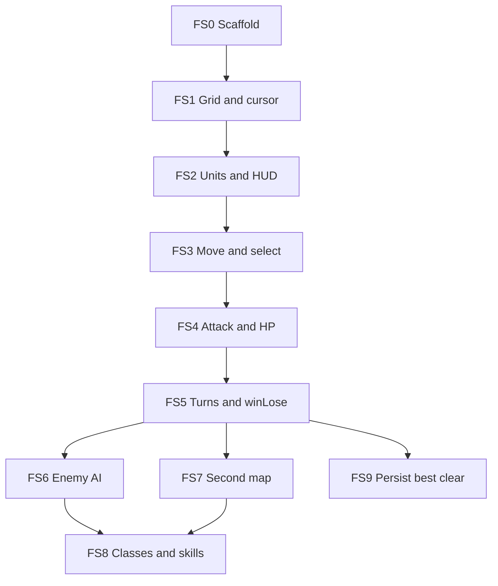

# Mono Tactics — Feasibility & Feature-Set Roadmap

Original **tactical RPG prototype** for Flipper Zero under `games/mono_tactics/`.

Inspired by the *genre* of classic 16-bit strategy RPGs (grid battles, turn order, classes). **Not** a port of Shining Force 2 or any copyrighted title — no Sega/Camelot story, maps, characters, dialogue, art, or ROM data.

| | |
|---|---|
| **Working title** | Mono Tactics |
| **App id** | `mono_tactics` |
| **Target** | Flipper Zero · 128×64 monochrome · C FAP via uFBT |
| **Audio** | None (v1–vN) |
| **Status** | Planning only — no implementation yet |

---

## 1. Feasibility verdict

| Question | Answer |
|----------|--------|
| Full Shining Force 2 port? | **No** — copyright + content size + screen |
| SF2-*like* tactics on Flipper with reduced graphics, no sound? | **Yes** — as a small original game |
| Fit this repo’s patterns? | **Yes** — same layout as Babal / Falldown |

### Legal / IP

- Do **not** embed or reverse-engineer SF2 (or any commercial) ROM, assets, maps, scripts, or music.
- Original names, maps, unit art, and dialogue only.
- Document inspiration at genre level only (grid tactics), same spirit as Falldown’s “classic calculator game” credit — not a binary dump.

### External reference: Aura4 SF2 remake (Shining Source)

Fan C# / XNA demo source released 2009 on [The Shining Source](https://www.shiningsource.org/2009/11/shining-force-2-remake-source-released/) ([download page](https://www.shiningsource.org/downloads/sf2-remake-source/)). Site marks Shining Aid code **Public Domain unless otherwise stated**.

| May use | Must not use |
|---------|----------------|
| **Ideas** about turn flow, move ranges, phase order, UI state machines — reimplemented from scratch in C for Flipper | Their **tree as a dependency** (no vendoring into this repo) |
| Generic tactics patterns (BFS move flood, acted flags, win when no enemies) | **SF2 story, maps, unit names, sprites, dialogue, music/MP3s**, or other Sega-derived content shipped with the remake |
| Notes in FEATURE docs: “studied X concept; our API is …” | Claiming Mono Tactics is an SF2 remake or port |

**Why copy is still wrong even if their *code* is PD:** public-domain fan code does not grant Sega’s rights in Shining Force 2 IP. Remake maps/sprites/script that reproduce the commercial game remain off-limits.

**Why it is a poor direct port target anyway:** C# + XNA + BASS on PC ≠ Flipper C FAP on 128×64 with no sound. Treat it as optional **reading**, not a codebase to transplant. Prefer B.A.B.S. / other Shining Aid engines the same way — mechanics notes only, until a content audit passes (below).

### Fan games: when a “port of a fan game” is OK

Porting a **fan-made** tactics game (not SF2) is fine **only if both** code **and** redistributable content (story, maps, graphics, names) are clearly licensed for reuse — and the package does **not** include Sega (or other commercial) rips.

**Audit checklist before treating any fangame as a port source:**

1. Written license for **code** (MIT, PD, GPL, etc.) and for **assets** (CC0, CC-BY, PD, or explicit “rip freely”).
2. Credits list: no “sprites from SF2 / sprites-resource rips / music from Genesis.”
3. Content is an **original** setting (new names, maps, dialogue) — not a retelling of SF2’s plot.
4. Still shrink for Flipper: 1–2 battles, ≤8 units, 1-bit redrawn glyphs (do not expect to ship PC/Java art as-is on 128×64).

| Candidate | Status for Mono Tactics |
|-----------|-------------------------|
| **Aura4 SF2 remake** | Code may be PD; **content is SF2** → not a fan-*original* port |
| **Rising Flame** (itch) | Author states some assets from SF / FF → **reject** |
| **ShiningForceRemade Assets-Original** | Explicit **sprite rips** → **reject** |
| **Classic Verge BABS** (2001) | Authors say open source **including graphics** (“may be ripped”) — closest Shining Source **engine demo**; tiny “stone-age” art. Could inspire a licensed micro-port **after** downloading and confirming no ripped commercial tiles in that specific package |
| **BABS 2.5 / Lycadell (Shiny Sword)** | Original *campaign* intent (Lycadell village, Elvenfyre graphics/text). Site marks aid **code** PD; asset license is looser / multi-author — **audit zip before reuse**; still Java/PC-scale for Flipper |
| **Genso Battle** | MIT code + **CC-BY-4.0 original assets** — clean licenses, but Touhou/Terra-Battle style, not SF; too big for Flipper as-is |
| **OpenGameArt CC0 kits** (e.g. Tiny Tactics) | Good for **original** Mono Tactics art (downscale/dither) — not a fangame story |
| **The Sparkling Farce** | MIT Godot *platform*; demo content is placeholders — not a finished fan story to port |

**Practical default for this repo:** keep Mono Tactics **original** (FS0–FS5). Optionally, after an audit, add a later FS that ports **one** tiny freely licensed battle scenario (e.g. verified BABS demo map) with Flipper-redrawn 1-bit sprites and credit line — never SF2 story/art.

### Hardware reality (Flipper Zero)

| Constraint | Impact on design |
|------------|------------------|
| **128×64 1-bit LCD** | Tiny grid (e.g. 8×6 cells), 2–8 px unit glyphs, no portraits, minimal HUD |
| **D-pad + OK / Back** | Cursor select → confirm; menus as short vertical lists; no chord-heavy UI |
| **FAP size / RAM** | Ship **one battlefield + few units** first; campaign data as compact tables, not huge tilemaps |
| **No useful game music path in scope** | Silent by design — frees stack/CPU and matches the ask |
| **Cloud agents can’t `ufbt launch`** | Each feature set must be verifiable with **host unit tests** + `ufbt` build/lint |

### What “reduced graphics” means here

- Top-down **cell grid** with 1-bit fill (checker / outline tiles).
- Units = distinct **silhouettes** (knight, archer, mage, enemy blob) — not animated sheets.
- Battle FX = blink / invert / 1-frame flash, not particle systems.
- Overworld (if ever) = node graph of battle nodes, not a walking town map.

### What will *not* fit (even later)

- Full SF2-length campaign, multi-screen cutscenes, recruiting dozens of named heroes with unique sprites.
- Faithful Genesis battle animations, zoomed combat scenes, shop towns with interiors.
- Emulating the Genesis ROM on-device.

---

## 2. Product north star (v1 demo)

A playable loop a stranger understands in under a minute:

1. Title → **Start**
2. One **battle**: place cursor, move, attack, end turn
3. Win (all enemies down) or lose (all allies down) → rematch / quit

Anything beyond that (second map, classes with skills, save) is a **later feature set**, planned and shipped separately.

---

## 3. How to plan each feature set independently

Treat every milestone as its own mini-project with a **FEATURE.md** (or a section in this file marked Done) that answers the same checklist. Do not start coding the next set until the previous one’s exit criteria pass.

### Template (copy per feature set)

```markdown
## FSn — <name>

### Goal
One sentence: what the player can do when this ships.

### In scope
- Bullet list of concrete behaviors / files

### Out of scope
- Explicit non-goals so scope cannot creep

### Dependencies
- Prior FSs that must already be Done (or “none”)

### Pure-C surface (host-testable)
- Types / functions with no furi_* / Canvas

### Flipper surface
- Views, input, draw only

### Acceptance tests
- Host: `make -C tests …` cases
- Device (when available): manual checklist

### Exit criteria
- [ ] Host tests green
- [ ] `ufbt` + `ufbt lint` green
- [ ] README controls updated
- [ ] This FS marked Done in PLAN.md
```

### Rules of independence

1. **One player-visible capability per FS** (or one invisible foundation with a smoke UI).
2. **No shared half-finished modules** — if FS3 needs pathfinding, either ship a stub in FS2 or put pathfinding entirely in FS3.
3. **Pure logic first** — put rules in `battle.c` / `grid.c` / `ai.c` with host tests; keep `mono_tactics.c` as a thin shell (Babal pattern).
4. **Data tables over engines** — maps and units as `const` structs until a later FS proves a loader is needed.
5. **Re-plan before expand** — when adding FS7+, write its FEATURE section *before* coding; do not grow “while we’re here.”

### Suggested agent workflow per FS

```text
1. Branch: cursor/mono-tactics-fsN-<slug>-fa43
2. Fill FEATURE checklist in PLAN.md (or FEATURES/fsN.md)
3. Implement pure C + host tests
4. Wire Flipper UI if needed
5. ufbt / ufbt lint / make -C tests
6. Commit, push, PR; mark FS Done
```

---

## 4. Feature sets (ordered)

Dependency graph (each node is independently plannable; arrows = hard deps):



FS6 / FS7 / FS9 can be reordered after FS5 if priorities change — re-plan that FS’s section first.

---

### FS0 — Scaffold (empty FAP)

| | |
|---|---|
| **Goal** | App builds and shows a title screen; Back exits |
| **In scope** | `application.fam`, `mono_tactics.c`, 10×10 icon, title canvas, `ufbt` CI-friendly tree |
| **Out of scope** | Any battle logic |
| **Dependencies** | None |
| **Host tests** | Optional compile smoke later; OK to skip until FS1 |
| **Exit** | `cd games/mono_tactics && ufbt && ufbt lint` |

---

### FS1 — Grid + cursor

| | |
|---|---|
| **Goal** | See an 8×6 (tunable) battlefield; move a cell cursor with the D-pad |
| **In scope** | `grid.h/.c` — width/height, index helpers; draw grid; cursor blink |
| **Out of scope** | Units, movement ranges |
| **Pure-C** | `grid_index`, clamp, in-bounds |
| **Host tests** | Bounds / index round-trip |
| **Exit** | Cursor moves; Back → title |

---

### FS2 — Units on the grid + minimal HUD

| | |
|---|---|
| **Goal** | 2–3 allies and 2–3 enemies drawn as distinct 1-bit glyphs; show selected unit name/HP when cursor is on them |
| **In scope** | `unit.h/.c` — team, hp, max_hp, x, y, class id; static battle setup; HUD line |
| **Out of scope** | Combat math, turn order |
| **Pure-C** | Unit list find-by-cell |
| **Host tests** | Placement uniqueness; HP clamp |
| **Exit** | Cursor over unit updates HUD |

---

### FS3 — Select + move

| | |
|---|---|
| **Goal** | OK on ally → show move range → OK on empty in-range cell moves unit |
| **In scope** | Move range flood-fill (Manhattan or 4-dir BFS with move points); occupied cells blocked |
| **Out of scope** | Attacking |
| **Pure-C** | `battle_move_range`, `battle_try_move` |
| **Host tests** | Range shapes; cannot pass through enemies; cannot leave map |
| **Exit** | One ally can reposition once per “action” stub (or free roam until FS5) — document choice in FEATURE notes |

**Default choice for independence:** free reposition until FS5 introduces “acted” flags — keeps FS3 testable without turn state.

---

### FS4 — Attack + damage

| | |
|---|---|
| **Goal** | After move (or instead), attack adjacent enemy; HP drops; 0 HP removes unit from field |
| **In scope** | Melee range 1; fixed damage table by class; death deselect |
| **Out of scope** | Magic, counters, miss chance (optional later) |
| **Pure-C** | `battle_can_attack`, `battle_resolve_attack` |
| **Host tests** | Damage; overkill; friendly fire forbidden |
| **Exit** | Manual fight until one side empty (even without AI — player can move both teams in debug, or only allies vs stationary enemies) |

**Default:** enemies are **stationary targets** until FS6 — keeps FS4 shippable alone.

---

### FS5 — Turns + win / lose

| | |
|---|---|
| **Goal** | Phase: Player → Enemy (even if enemy does nothing yet) → …; win/lose screens |
| **In scope** | Acted flags; End Turn (long-press OK or menu item); victory / defeat views |
| **Out of scope** | Smart AI |
| **Pure-C** | Turn state machine |
| **Host tests** | Phase transitions; win when no enemies; lose when no allies |
| **Exit** | Full silent battle vs stationary foes; rematch from result screen |

---

### FS6 — Enemy AI (minimal)

| | |
|---|---|
| **Goal** | On enemy phase, each living enemy moves toward nearest ally and attacks if in range |
| **In scope** | Greedy nearest-target; reuse move/attack pure functions |
| **Out of scope** | Formation AI, healing priority, difficulty levels |
| **Pure-C** | `ai_choose_action` |
| **Host tests** | Deterministic fixtures (fixed seed or pure greedy) |
| **Exit** | Player can lose to AI without cheating |

---

### FS7 — Second battle map

| | |
|---|---|
| **Goal** | Win battle 1 → battle 2 with different layout / unit counts |
| **In scope** | `maps/` const tables; campaign index 0→1; title “Campaign” |
| **Out of scope** | Towns, shops, dialogue trees |
| **Pure-C** | Map blob + loader into battle state |
| **Host tests** | Map dimensions; spawn points valid |
| **Exit** | Two-map clear path |

---

### FS8 — Classes & one skill each (optional stretch)

| | |
|---|---|
| **Goal** | Fighter / Archer / Mage feel different (range, damage); one simple skill (e.g. mage bolt range 2) |
| **In scope** | Class stats table; skill as second attack mode |
| **Out of scope** | Promotion, inventory, spells list UI |
| **Exit** | Host tests for range/damage per class |

---

### FS9 — Persist “best clear”

| | |
|---|---|
| **Goal** | Remember fastest clear (turns) or wins count on SD |
| **In scope** | `storage` API; title shows best |
| **Out of scope** | Mid-battle save |
| **Exit** | Survive app restart |

---

## 5. Proposed tree (after FS0–FS2)

```text
games/mono_tactics/
  PLAN.md                 ← this document
  README.md               ← controls / build (update per FS)
  application.fam
  mono_tactics.c          ← entry, views, input, draw
  icons/mono_tactics_10px.png
  grid.h / grid.c
  unit.h / unit.c
  battle.h / battle.c     ← from FS3+
  ai.h / ai.c             ← FS6
  maps/                   ← FS7
  tests/
    Makefile
    test_grid.c
    test_battle.c
    …
```

Follow [AGENTS.md](../../AGENTS.md) and [`.cursor/skills/flipper-fap-build/SKILL.md`](../../.cursor/skills/flipper-fap-build/SKILL.md): release-channel uFBT, host tests for pure C, do not commit `.ufbt/` or `dist/`.

---

## 6. Controls (target, refine per FS)

| Key | Battle | Menus |
|-----|--------|-------|
| Left / Right / Up / Down | Move cursor | Move selection |
| OK | Select / confirm | Confirm |
| Back | Cancel / title / exit | Back / exit |

No sound. No Video Game Module requirement.

---

## 7. Risks & mitigations

| Risk | Mitigation |
|------|------------|
| Scope creep toward “full RPG” | Hard FS out-of-scope lists; campaign max 2–3 maps until proven |
| Unreadable 128×64 battles | Cap grid ≤ 8×6; max ~8 units on screen; thick glyphs |
| Untestable GUI blobs | All rules in pure C; GUI only paints state |
| Accidental IP use | Original names only; no ripped assets; review art/text before merge |

---

## 8. Immediate next step

When ready to leave planning: **implement FS0 only** on a dedicated branch, using the FEATURE checklist above. Do not start FS1 in the same PR.
